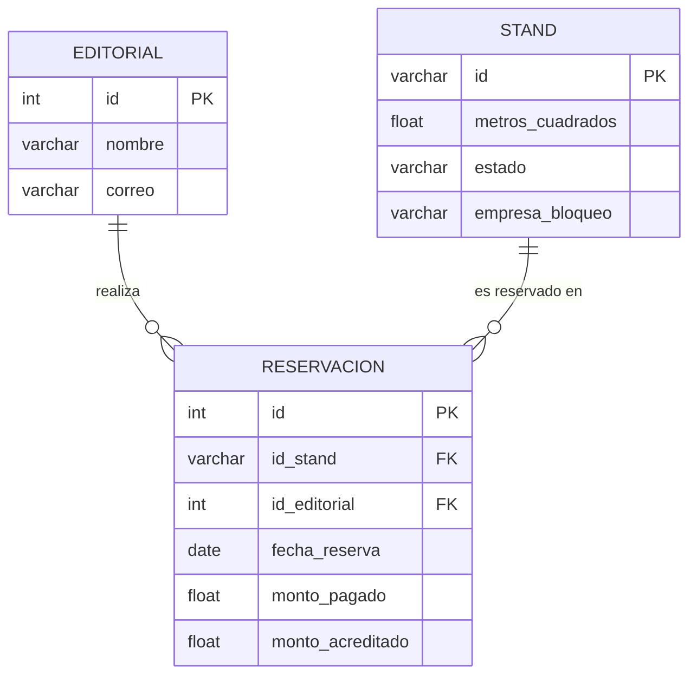
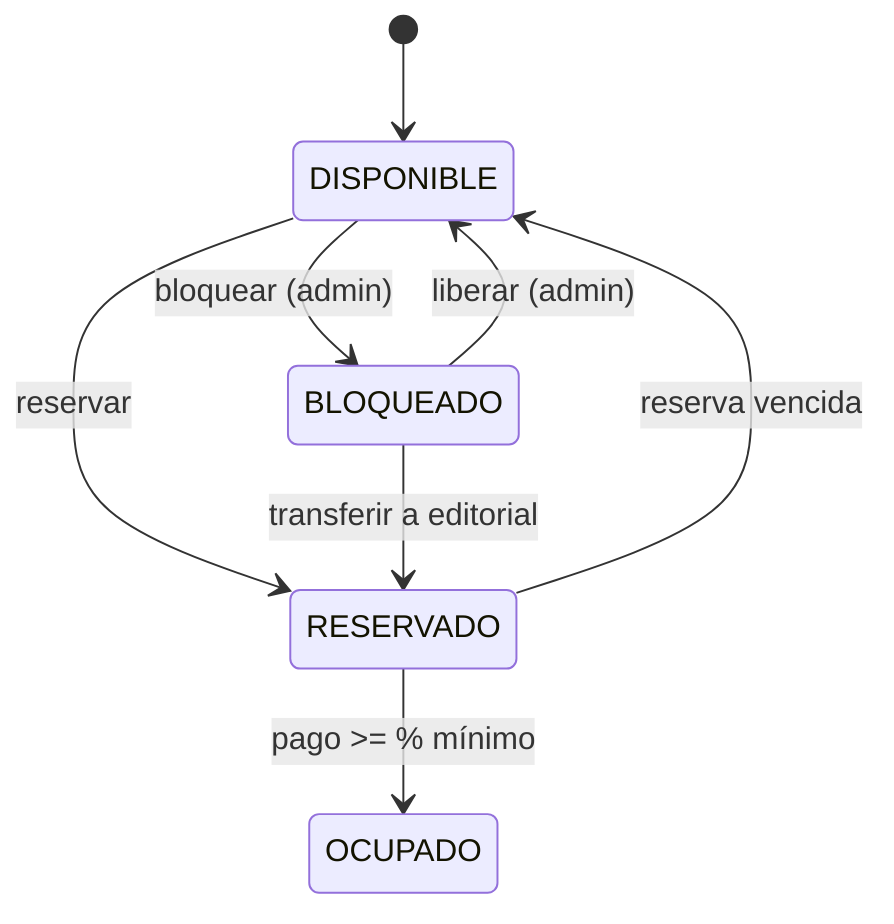
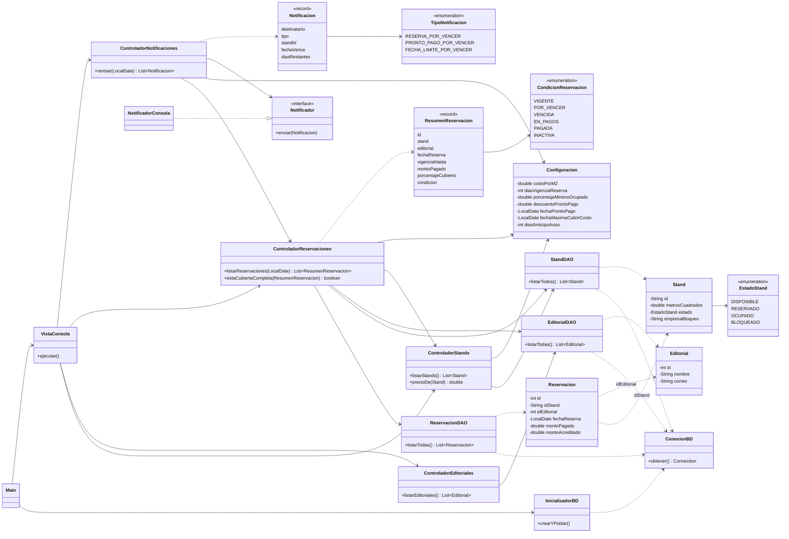

# Sistema administrativo de venta de stands

Aplicación de línea de comandos en Java 17 para administrar la venta de stands a editoriales. Los datos se leen de una base de datos relacional mediante JDBC y el código está organizado por capas (modelo, controlador, persistencia y vista).

## Video explicativo

URL del video (máximo 5 minutos, con acceso verificado): _pendiente de agregar_

## Ejecutar

Con Maven (descarga el conector de H2 automáticamente):

```bash
mvn compile exec:java
```

Sin Maven, usando el conector incluido en `lib/`:

```bash
mkdir -p out
javac -encoding UTF-8 -cp lib/h2-2.2.220.jar -d out $(find src/main/java -name "*.java")
java -cp "out:src/main/resources:lib/h2-2.2.220.jar" com.feria.app.Main
```

(en Windows el separador del classpath es `;` en lugar de `:`).

Al iniciar, `main()` crea la base de datos H2 (en memoria), ejecuta `schema.sql` y `datos.sql`, muestra que la conexión a la BD fue exitosa y presenta los listados de Stands, Editoriales y Reservaciones leídos con JDBC. Después queda disponible la línea de comandos para consultas adicionales.

### Comandos

| Comando | Descripción |
|---|---|
| `stands` | Lista de stands (estado, metros cuadrados y precio calculado) |
| `editoriales` | Lista de editoriales registradas |
| `reservaciones` | Lista de reservaciones con vigencia, monto pagado, porcentaje cubierto y condición |
| `listados` | Muestra los tres listados seguidos |
| `config` | Muestra la configuración del sistema |
| `fecha [AAAA-MM-DD \| +N \| -N]` | Ve o cambia la fecha del sistema (para pruebas) |
| `notificar` | Revisa vencimientos y envía avisos a las editoriales |
| `salir` | Termina el programa |

Ejemplo de prueba de notificaciones:

```
> listados
> notificar
> fecha +28
> notificar
```

## Requisitos

**Funcionales**
- RF1. Mapear los stands con identificador, metros cuadrados y estado (disponible, reservado, ocupado, bloqueado), leídos desde la base de datos.
- RF2. El precio de un stand se calcula con sus dimensiones: m² × costo por m² (configurable); no se almacena en la base de datos.
- RF3. Reservado: la editorial paga después; la reservación tiene tiempo de vigencia (fecha de reserva + días de vigencia configurables). Si vence sin llegar al porcentaje mínimo, se muestra como vencida.
- RF4. Ocupado: el stand pasa a ocupado cuando el pago cubre al menos el porcentaje mínimo; se sigue pagando hasta cubrir el 100 %.
- RF5. Bloqueado: reserva especial del administrador (negociación previa a la salida del sistema).
- RF6. Descuento por pronto pago: los pagos hasta la fecha límite de descuento acreditan más de lo pagado (monto acreditado vs. monto pagado).
- RF7. Fecha máxima para cubrir el costo total.
- RF8. Porcentaje mínimo configurable para pasar de reservado a ocupado.
- RF9. **Notificar a las editoriales** cuando: su reservación esté por vencer, el pronto pago esté por vencer, o la fecha límite para cubrir el costo esté por vencer. Las reservaciones vencidas no generan avisos.
- RF10. El sistema consulta la base de datos, reconstruye los objetos y devuelve tres listados completos: stands, editoriales y reservaciones (reflejando sus condiciones y estados).

En esta etapa solo se realizan operaciones de lectura (`SELECT`). Las operaciones de escritura (reservar, pagar, bloquear, liberar, transferir) quedan para la siguiente etapa.

**No funcionales**
- RNF1. Funciona por línea de comandos.
- RNF2. Código separado en paquetes: `modelo`, `controlador`, `persistencia`, `vista`, `notificaciones`, `configuracion` y `app`.
- RNF3. Los datos viven en una base de datos relacional (H2) accedida con JDBC (`DriverManager`, `Statement`, `ResultSet`), cerrando siempre las conexiones.
- RNF4. El modelo contiene solo datos mínimos (sin lógica de negocio); toda la lógica está en los controladores y cada controlador atiende un solo proceso.
- RNF5. Todas las clases que se conectan a la base de datos están en el paquete `persistencia`.
- RNF6. El canal de notificación es intercambiable (interfaz `Notificador`).

## Arquitectura

| Capa | Paquete | Contenido |
|---|---|---|
| Modelo | `com.feria.modelo` | `Stand`, `Editorial`, `Reservacion`, `EstadoStand` |
| Controlador | `com.feria.controlador` | `ControladorStands`, `ControladorEditoriales`, `ControladorReservaciones`, `ControladorNotificaciones` |
| Persistencia | `com.feria.persistencia` | `ConexionBD`, `InicializadorBD`, `StandDAO`, `EditorialDAO`, `ReservacionDAO` |
| Vista | `com.feria.vista` | `VistaConsola` |
| Notificaciones | `com.feria.notificaciones` | `Notificacion`, `TipoNotificacion`, `Notificador`, `NotificadorConsola` |
| Configuración | `com.feria.configuracion` | `Configuracion` |
| Arranque | `com.feria.app` | `Main` |

Flujo de una consulta: `VistaConsola` → controlador → DAO → base de datos. El DAO recorre el `ResultSet` y reconstruye los objetos del modelo; el controlador calcula lo que no se guarda (precio, vigencia, porcentaje cubierto, condición) y devuelve el resultado a la vista.

## Base de datos

Tres tablas, definidas en `src/main/resources/db/schema.sql` y pobladas con `datos.sql`:



- `stand.estado` guarda el nombre del estado (`DISPONIBLE`, `RESERVADO`, `OCUPADO`, `BLOQUEADO`).
- La vigencia de la reservación, el precio del stand y el porcentaje cubierto se calculan en el controlador.

La conexión se define en `ConexionBD` (por defecto H2 en memoria). Puede cambiarse con `-Ddb.url`, `-Ddb.user` y `-Ddb.password`.

## Estados de un stand



## Diagrama de clases


